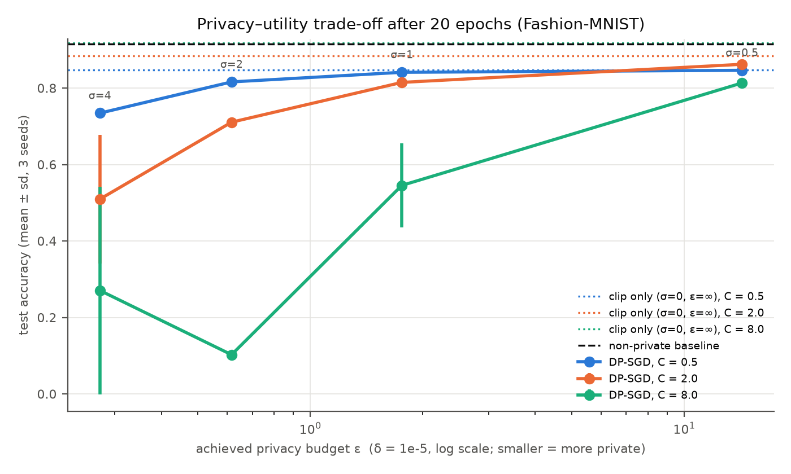
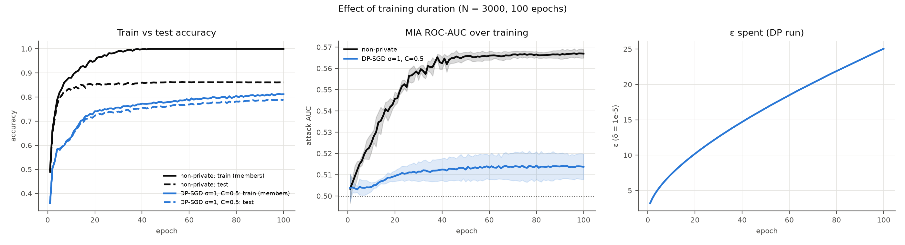

# DP-SGD CNN Training + Membership Inference

**Differentially Private SGD**, implemented from scratch for a CNN on Fashion-MNIST. It includes:
- Per-example gradient clipping and calibrated Gaussian noise.
- A Rényi-DP privacy accountant, checked against Opacus.
- A membership inference attack.

Experiments show how the noise multiplier, clipping norm, training duration and dataset size affect accuracy, convergence, the privacy budget ε and real leakage.

This is Question 3 of Assignment 3 for *Responsible AI for Foundation Models (DSE428/DSE628)*, IISER Bhopal.
The report covering all three questions is in [`docs/`](docs): [short version, 4 pages](docs/Assignment3_Short_Report.pdf) and [full report](docs/Assignment3_Report.pdf).

## Method

For every step of DP-SGD:
1. **Poisson-sample a batch**, with q = B/N and expected batch size B = 256.
2. **Compute per-example gradients** `g_i`, using `torch.func.vmap(grad(·))`.
3. **Clip each gradient:** `ḡ_i = g_i · min(1, C / ‖g_i‖₂)`.
4. **Add noise and average:** `g̃ = (1/B) · (Σ ḡ_i + N(0, σ²C²I))`.
5. **Apply SGD** (lr 0.05, momentum 0.9).

**Verification:**
- The clipped sum matches a hand-written per-example loop to within 1e-8.
- The noise standard deviation equals σC.
- The privacy accountant (RDP of the sampled Gaussian, 99 fractional and 245 integer orders, δ = 1e-5) **matches Opacus to within 1e-12**.

**Membership inference:**
- The attack is a loss-threshold attack: members are training examples and non-members are held-out test images.
- It reports AUC with a 95% CI, plus membership advantage and TPR at 1% FPR. For these two, the threshold is chosen on one half of the data and evaluated on the other half.

## How to run

```bash
pip install -r requirements.txt
python dp_sgd.py gradnorms          # per-example gradient-norm statistics (used to choose C)
python dp_sgd.py accountant-check   # our epsilon vs Opacus
python dp_sgd.py run                # 72 runs (3 seeds) + figures; resumable
python dp_sgd.py plot
```

## Results (N = 60k, 20 epochs, 3 seeds)

| Setting | ε (δ = 1e-5) | Acc. % C = 0.5 | C = 2 | C = 8 | MIA AUC (C = 0.5) |
|---|---|---|---|---|---|
| non-private | ∞ | 91.5 | | | 0.523 |
| clip only (σ = 0) | ∞ | 84.7 | 88.5 | 91.7 | 0.505 |
| σ = 0.5 | 14.28 | 84.6 | 86.2 | 81.3 | 0.505 |
| σ = 1 | 1.76 | 84.1 | 81.5 | 54.5 | 0.506 |
| σ = 2 | 0.62 | 81.6 | 71.1 | 10.2 | 0.505 |
| σ = 4 | 0.27 | 73.4 | 50.9 | 27.1 | 0.506 |



- **More noise** gives a stronger guarantee (smaller ε) and lower accuracy. ε ≈ 1.8 costs about 7 pp.
- **Clipping:**
  - A small C biases the update.
  - A large C lets the noise σC overwhelm the signal, and C = 8 with σ ≥ 1 fails to train.
  - The best C shrinks as σ grows.
- **Training duration** (N = 3,000, 100 epochs):
  - The non-private model memorises its training data: train accuracy 100%, MIA AUC 0.567, advantage 0.246.
  - DP keeps the attack near chance (AUC 0.514), but ε keeps growing with every step, reaching 25.
- **Dataset size:** a smaller N means a larger sampling rate, so ε rises (1.76 at 60k → 10.2 at 3k) and accuracy drops.



`results/` holds:
- per-epoch logs for every run
- `summary.csv`
- the accountant cross-check
- gradient-norm statistics
- figures

`results_v1/` keeps the first run, made before evaluation-driven fixes: fractional RDP orders and an unbiased MIA threshold.

## AI use

All code was generated with **Claude Opus 5.5** (Anthropic, `claude-opus-5-5`) through Claude Code, following my prompts. The complete, verbatim prompt log is in Appendix A of the [full report](docs/Assignment3_Report.pdf).
